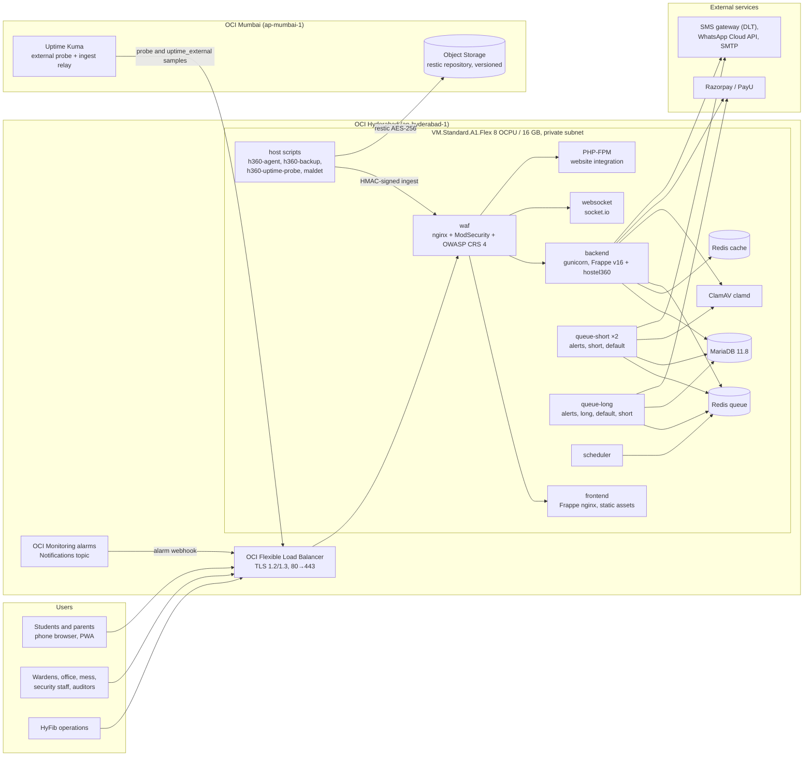
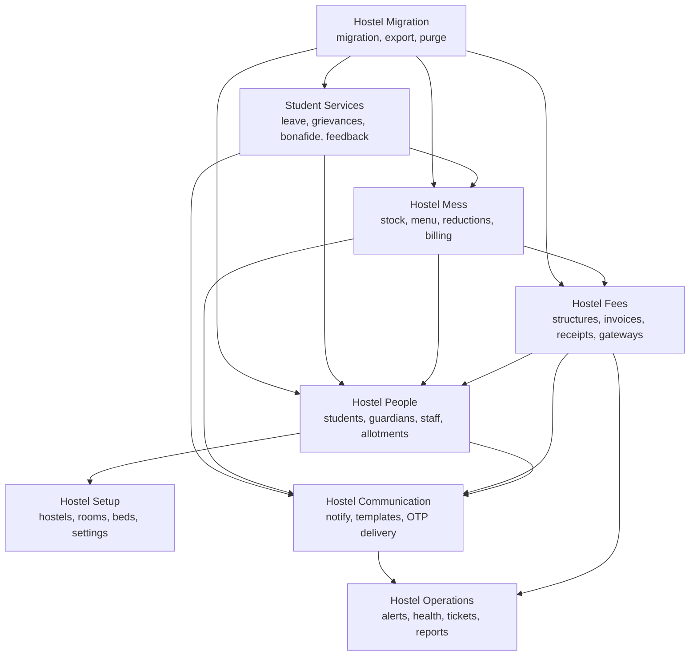
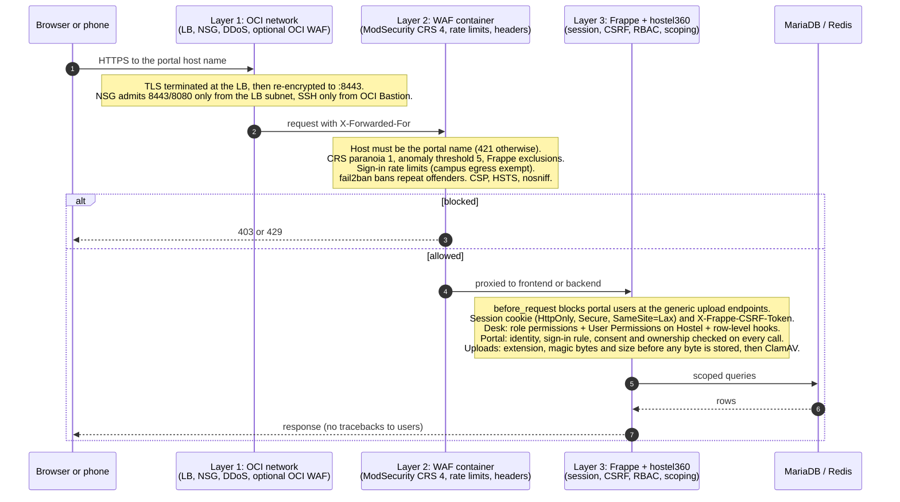
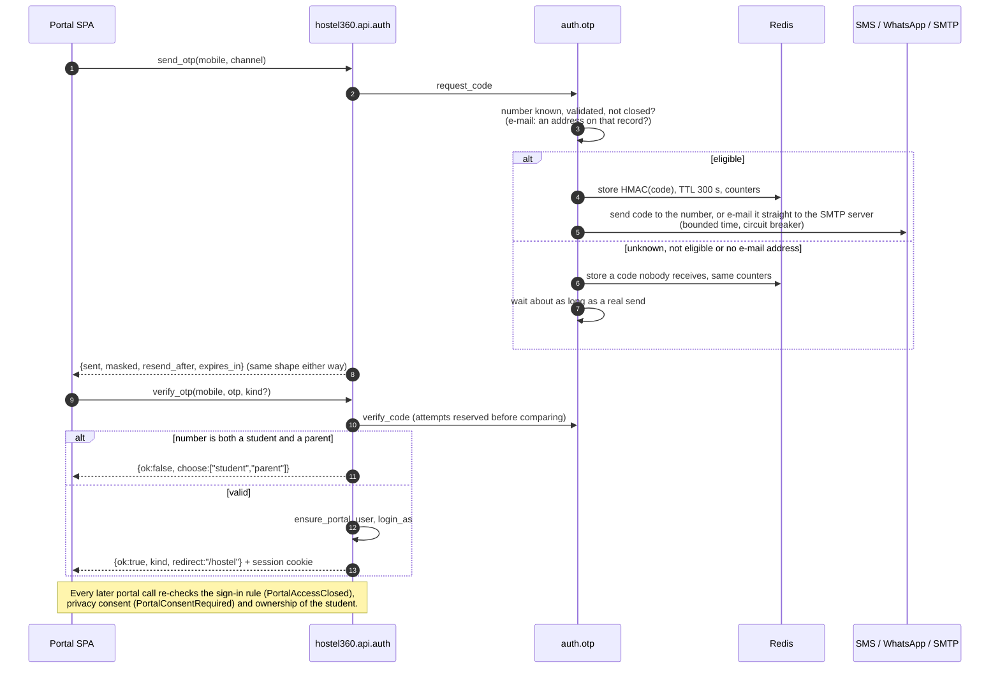
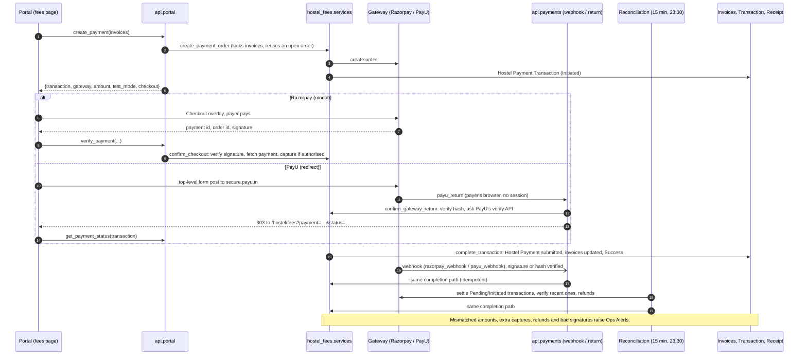
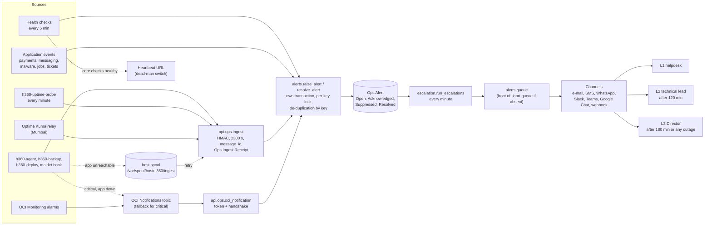

# Architecture

This document explains how HyFib Hostel360 is put together and why. The contract-level
detail (every DocType, field, permission and function signature) is in
[SOLUTION-DESIGN.md](SOLUTION-DESIGN.md); the production build and run instructions are in
`deploy/README.md`.

## 1. Components

| Component | Responsibility | Code |
|---|---|---|
| Frappe desk | Staff UI: workspaces per area, forms with custom actions, reports, desk pages (Room Board, Approvals, Gate Pass, Operations Status) | `hostel360/*/workspace`, `*/page`, `*/report`, `*.js` beside each DocType |
| Portal SPA | Student and parent UI at `/hostel` (Vue 3, PWA), talking only to `hostel360.api.portal` and `hostel360.api.auth` | `frontend/`, `hostel360/www/hostel.py` |
| Portal API | The only path from a portal user to data: identity, consent and ownership checks, then the module service | `hostel360/api/portal.py`, `hostel360/utils/context.py` |
| Module services | Business rules shared by the portal, desk and other modules | `hostel360/<module>/services.py` and DocType controllers |
| Gateways | Razorpay and PayU adapters behind one `PaymentGateway` interface | `hostel360/hostel_fees/gateways/` |
| Messaging | Template rendering (sandboxed Jinja), SMS/WhatsApp/e-mail providers with circuit breakers, Message Log, retries | `hostel360/hostel_communication/` |
| Operations | Health checks, alerts, escalation, channels, support SLAs, monthly report, ingest | `hostel360/hostel_operations/`, `hostel360/api/ops.py`, `hostel360/api/health.py` |
| Security | Upload policy, malware scanning, sharing rules, security event log | `hostel360/security/` |
| Migration | Legacy migration, exit export, verification, purge and certificate | `hostel360/hostel_migration/`, `hostel360/commands/` |
| Infrastructure | Image, Compose stack, WAF, Terraform, Ansible, host scripts, monitoring | `deploy/` |

### Modules and their dependencies

Modules call each other only through the service functions in SOLUTION-DESIGN §5 (imported
lazily, so a module that is not installed yet never breaks another). Mess billing turns its
bills into fee invoices through `hostel_fees.services.create_invoice`; an approved leave asks
`hostel_mess.services.apply_mess_reduction` for the reduction; every module notifies people
through `hostel_communication.dispatch.notify` and reports problems through
`hostel_operations.alerts.raise_alert`.

## 2. Request path through the three security layers

The layers are independent: the WAF does not trust the application to reject bad input,
and the application does not trust the WAF to have caught it. Details and file references
per control are in [SECURITY.md](SECURITY.md).

## 3. Portal sign-in and session rules

## 4. Payments

Collections go straight to ACGCET's merchant account. Hostel360 never trusts the browser:
a receipt is issued only after the payment has been read back from the gateway, and the same
completion path (`hostel_fees.transactions.complete_transaction`, idempotent and locked per
transaction) is used by the checkout callback, the return post, the webhook and
reconciliation, so whichever arrives first issues the one receipt.

Test mode: while Payment Settings has **Test Mode** on, only the designated test payers (and
administrators) can pay online, receipts are marked `is_test` and excluded from collection
figures, and the portal tells the payer that no real money is taken.

## 5. Alerting pipeline

- A stable **alert key** identifies a problem (`health.redis.cache`, `backup.daily.failed`,
  `host.disk.data.<host>`). While an alert with that key is open, repeats only bump its
  counters; a key resolved and raised again within 15 minutes re-opens the same alert quietly.
- `raise_alert` writes on a second database connection, so an alert survives the failure of
  the request that raised it and never rolls back the caller's work.
- Escalation follows Ops Alert Settings: L1 at once, L2 after 120 minutes unresolved, L3
  after 180 minutes or immediately for an outage. Critical alerts that nobody acknowledges
  are repeated every `critical_renotify_minutes` (60).
- Deliveries go to the `alerts` job queue, which every worker serves first, so a page never
  waits behind thousands of fee notifications.
- When the application itself is down, host-side alerts wait in the spool (24 hours, 2,000
  messages; uptime samples 35 days) and critical ones go straight to the OCI Notifications
  topic. Uptime Kuma in Mumbai sees VM and region outages that nothing on the VM can.

The full list of alert keys and what to do about each is in
[OPERATIONS-RUNBOOK.md](OPERATIONS-RUNBOOK.md#4-alert-catalogue).

## 6. Background work

| Queue | Used for |
|---|---|
| `alerts` | Operations alert deliveries only (defined by the configurator; listed first by every worker) |
| `short` | Notifications (`notify` → `deliver`), malware scans, small jobs |
| `default` | Frappe defaults |
| `long` | Publishing dues, mess bill computation and publishing (runs above 250 bills), bulk student import, migration runs |

Scheduled jobs are listed in SOLUTION-DESIGN §9. The scheduler runs in its own container; the
health checks raise `health.scheduler` when minute jobs stop running.

## 7. Data and records

- **Hostel scoping.** Every transactional record carries a `hostel` link copied from the
  student (`current_hostel`, or `last_hostel` once they have left). User Permissions on
  Hostel filter desk lists for hostel-scoped staff; row-level hooks add block, guardian,
  mess, confidentiality and Message Log rules (SOLUTION-DESIGN §3).
- **History is never deleted.** Allotments are transferred or vacated, invoices and receipts
  are cancelled and amended, grievances keep a timeline. Every DocType tracks changes.
- **Money** is stored in rupees with two decimals and crosses the gateway boundary in paise
  as integers.
- **Files** are private unless an administrator publishes them; portal uploads are always
  private and served through the portal API after the same ownership checks.
- **Time** is Asia/Kolkata throughout; the portal shows hostel time even on a phone set to
  another zone.

## 8. Deployment topology

| Environment | Where | Notes |
|---|---|---|
| Production | OCI Hyderabad, one A1 Flex VM, LB, Bastion; backups in Mumbai | `deploy/README.md` |
| Staging | Same shape (required for the load test) | `h360_environment: staging` |
| Development | `deploy/dev/compose.yml` on a workstation | [DEVELOPMENT.md](DEVELOPMENT.md) |

Releases are container images tagged `<version>-<git sha>`, built for arm64 and amd64 and
pushed to OCIR; `h360-deploy <tag>` on the server migrates with a pre-deploy dump and rolls
back automatically on failure. The GitHub workflows that build and deploy them are described
in [DEPLOYMENT.md](DEPLOYMENT.md#3-continuous-integration-and-delivery).

## 9. Design decisions

| Decision | Why |
|---|---|
| Frappe as the platform | Mature role/permission model, audit trail, reports with Excel/PDF export, background jobs and a desk the office can use without custom UI for every list |
| Portal as a separate SPA over a narrow API | Students and parents never get DocType permissions; one module (`api/portal.py`) holds every ownership check, and the phone UI can be fast and bilingual |
| OTP sign-in to the registered mobile | Students and parents already have the number on record; no passwords to forget or share. The code can also go to the e-mail address on record (optional), but the mobile number stays the identifier |
| Same response for unknown numbers | The sign-in page cannot be used to find out who lives in the hostel |
| Alerts in their own transaction | A failing payment webhook must still leave an alert behind; two callers raising the same key must not deadlock each other's work |
| Dividing-system mess billing in the app | The month's cost divided by student-days is the institution's rule; bills become fee invoices so dues, payment and receipts work the same way |
| One VM with Compose | Meets the tendered sizing with headroom, keeps operations simple, and the RTO of 4 hours is met by rebuilding from Terraform and Ansible plus a restore |
| restic to another Indian region | Encrypted, incremental, versioned off-site copies the server itself cannot purge; ACGCET gets read-only access |
