# Security

How HyFib Hostel360 protects ACGCET's data: the controls at each of the three layers the
tender asks for (TR 9), access control and authentication, uploads and malware, logging
and time (CERT-In), incident reporting, and personal data (DPDP Act 2023). Each control
names the file that implements it, so it can be audited.

To report a vulnerability, see [`SECURITY.md`](../SECURITY.md) at the repository root.

## 1. Three layers

```mermaid
flowchart LR
    U["User"] --> L1
    subgraph L1["Layer 1: network (OCI)"]
        A1["Load balancer, TLS 1.2/1.3"]
        A2["NSGs: 443/80 to the LB only,<br/>8443/8080 from the LB subnet only"]
        A3["Private subnet, no public IP,<br/>SSH only via OCI Bastion"]
        A4["OCI DDoS protection,<br/>optional OCI WAF"]
    end
    L1 --> L2
    subgraph L2["Layer 2: web and host"]
        B1["ModSecurity + OWASP CRS 4<br/>PL1, anomaly 5"]
        B2["Rate limits, fail2ban,<br/>security headers, CSP"]
        B3["ufw + DOCKER-USER,<br/>SSH hardening, auditd"]
        B4["ClamAV scan-on-upload,<br/>Linux Malware Detect"]
    end
    L2 --> L3
    subgraph L3["Layer 3: application"]
        C1["Roles, hostel and block scoping,<br/>row-level rules"]
        C2["2FA for every desk user,<br/>OTP for the portal"]
        C3["Upload policy, CSRF,<br/>rate limits per user"]
        C4["Audit trail, security log,<br/>encrypted secrets"]
    end
```

### Layer 1 — network

| Control | Implementation |
|---|---|
| Server in a private subnet with no public IP; only the load balancer is public | `deploy/terraform/oci/network.tf`, `compute.tf` |
| NSG: the LB admits 80/443; the server admits 8443/8080 only from the LB's NSG; SSH only from the Bastion endpoint; egress limited to 80/443/465/587 and NTP | `network.tf` (`app_egress_tcp_ports`) |
| OCI Bastion with an allow-list of HyFib office addresses and 3-hour sessions; no other administrative path | `bastion.tf` (`bastion_client_cidrs`, `bastion_max_session_ttl_seconds`) |
| TLS 1.2/1.3 with forward-secret AEAD ciphers at the LB, HTTP redirected to HTTPS, re-encrypted to the server | `lb.tf` |
| IMDSv2 only; containers cannot reach the metadata service | `compute.tf`, `deploy/ansible/roles/firewall` |
| OCI DDoS protection (platform), optional OCI WAF with a rate limit | `waf.tf` (`enable_oci_waf`) |
| VCN flow logs and LB logs in OCI Logging, 180 days | `logging.tf` |

### Layer 2 — web application firewall and host

| Control | Implementation |
|---|---|
| ModSecurity with OWASP CRS 4.30, paranoia level 1, inbound anomaly threshold 5, rule exclusions scoped to Frappe paths and arguments | `deploy/waf/`, `deploy/compose/compose.yml` (`BLOCKING_PARANOIA`, `ANOMALY_INBOUND`) |
| Only the portal host name is served (421 for anything else) | `deploy/waf/templates/conf.d/default.conf.template` |
| Rate limits per client address: OTP endpoints 120/min (burst 60), desk login and password reset 30/min (burst 20); campus egress addresses exempt | same, `00-hostel360.conf.template`, `rate-exempt.conf` |
| fail2ban bans repeated failed sign-ins (401/403), CRS blocks and rate-limit excess at the WAF, by the real client address; campus and stack addresses never banned | `deploy/ansible/roles/fail2ban`, `deploy/host/bin/h360-waf-ban` |
| Headers: HSTS, CSP (strict for `/hostel`: no inline script; Razorpay and PayU allowed only where needed), X-Frame-Options, nosniff, Referrer-Policy, Permissions-Policy, COOP | `deploy/waf/templates/includes/h360-security-headers.conf.template` |
| Host firewall (ufw, DOCKER-USER), SSH keys only, no root login, modern algorithms, sysctl hardening, unattended security updates, auditd rules, login banner | `deploy/ansible/roles/{firewall,ssh,common,auditd}` |
| Containers: non-root application image, `no-new-privileges`, capabilities dropped, read-only root file systems where possible, internal networks for the data tier and PHP | `deploy/compose/compose.yml` |
| ClamAV (clamd) scans every upload; Linux Malware Detect monitors in real time and scans daily, with quarantine | `deploy/clamav/`, `deploy/ansible/roles/malware`, `hostel360/security/files.py` |

### Layer 3 — application

| Control | Implementation |
|---|---|
| Role-based access with eleven roles; desk permissions per DocType; portal users have no DocType permissions at all | `hostel360/setup/roles.py`, DocType JSON permissions, SOLUTION-DESIGN §3 |
| Hostel scoping through User Permissions synchronised from Hostel Staff; block, guardian, mess, confidential-grievance and Message Log rules as permission hooks, judged on stored values | `hostel_people/permissions.py`, `student_services/permissions.py`, `hostel_mess/permissions.py`, `hostel_communication/permissions.py`, `hooks.py` |
| System-maintained fields cannot be changed through the API | `hostel_people/protection.py`, `student_services/utils.assert_unchanged` |
| Portal: every call resolves the caller, re-checks the sign-in rule, requires privacy consent, and checks ownership of the student before calling the module service | `hostel360/api/portal.py`, `hostel360/utils/context.py` |
| CSRF token on every state-changing call; session cookies `HttpOnly; Secure; SameSite=Lax`; 8-hour sessions | Frappe, `hostel360/setup/install.py` (`session_expiry`) |
| Rate limits per signed-in user on every portal write (a campus shares public addresses) | `RATE_LIMITS` in `api/portal.py` |
| Errors never show tracebacks to users | `allow_error_traceback = 0` in `setup/install.py` |
| Secrets (gateway keys, SMS/WhatsApp tokens, ingest secret) are Password fields, encrypted with the site key | DocType definitions |
| Sharing restrictions: no "share with everyone" and no shares to accounts without desk access for Hostel360 records and personal-data core records | `hostel360/security/sharing.py` (DocShare `validate` hook registered in `hooks.py`; older shares removed on every migrate) |

## 2. Authentication

### Staff: password and two-factor authentication (T&C 28)

- Two-factor authentication is switched on for the site with an authenticator app ("OTP
  App") and required for every Hostel360 desk role and for Frappe's System Manager and
  Administrator roles (`setup/roles.py`, `TWO_FACTOR_CORE_ROLES`; re-applied on every
  migrate).
- Password policy: minimum strength score 3, lockout after 5 consecutive failures for
  10 minutes, forced password change every 180 days, logout on password reset, at most 3
  reset e-mails (`SECURITY_SETTINGS` in `setup/install.py`).
- First enrolment of the Administrator happens on the server (`h360-2fa-enrol`); other
  users receive their QR code by e-mail at the first sign-in; a lost phone is reset with
  `h360-2fa-enrol --reset <user>` (`deploy/README.md` §3.5).
- Desk logins are created only from Hostel Staff records with a designation, so every login
  has an owner, a role and (where applicable) hostel assignments; deactivating the staff
  record disables the login.

### Students and parents: one-time codes (3.2, 4.2)

| Control | Value |
|---|---|
| Code | 6 random digits from `secrets`, valid 300 seconds; stored only as HMAC-SHA256 (key derived from the site encryption key, bound to the number) in Redis; Redis keys carry an HMAC of the number, never the number |
| Channels | SMS (DLT-registered template) or WhatsApp authentication template to the number; optionally e-mail (Messaging Settings > *Allow E-mail Sign-in Codes*) to the address on the student or guardian record that holds the number, never to a placeholder `.invalid` portal address. An e-mailed code signs in only the records registered with that address, so a student sharing a parent's phone cannot sign in as the parent from their own inbox. E-mailed codes go straight to the SMTP server inside the request: no Email Queue copy of the code, 3-second steps, circuit breaker; the code is kept out of the subject line |
| Per number | resend after 60 s, 5 codes an hour, 5 wrong guesses invalidate a code, 10 failed verifications an hour lock the number for an hour (staff can lift it with **Unlock Sign-in**) |
| Per address | 20 codes an hour (campus egress addresses in Messaging Settings > Trusted Networks exempt), 100 failed verifications an hour, coarse flood guard of 3,000 calls an hour |
| Enumeration | Unknown, unvalidated and closed numbers, numbers with no e-mail address on record and e-mail requests while e-mail codes are off get the same response (always the masked mobile number, never an address) and timing (measured separately for e-mail), and count against the same limits; the limits are shared by every channel |
| Who may sign in | Only validated students who are not Vacated/Alumni, and parents linked to at least one such student (3.1, 4.1); asked again on every portal call |
| Separation | A portal account can never hold a desk role (`auth/events.validate_user`) |
| Security log | Sign-ins, blocks, locks and unlocks in `logs/hostel360_security.log` with masked numbers and hashed user IDs |

Implementation: `hostel360/auth/otp.py`, `hostel360/api/auth.py`, `hostel360/auth/events.py`,
`hostel360/security/audit.py`.

## 3. Uploads and malware

| Rule | Value |
|---|---|
| Allowed types | Students and parents: PDF, JPG, JPEG, PNG, WEBP. Staff: also XLSX, XLS, CSV |
| Content check | Magic bytes must match the extension; spreadsheets must open as ZIP or OLE containers; CSV must be plain text |
| Size | 5 MB for portal users, 10 MB for staff |
| Storage | Portal uploads are always private and served only through the portal API after the same ownership checks as their grievance; image EXIF data is stripped |
| Path | Students and parents can upload only through `api.portal.upload_attachment` (quota of 20 unattached files a day; unused uploads deleted after 24 hours); Frappe's generic upload and insert endpoints are refused for them before the request body is read |
| When | The policy runs before Frappe writes any bytes (`File` override `HostelFile`) |
| Malware | Every upload is queued for a ClamAV scan; an infected file is deleted with every record that points to the same content and raises a Critical alert. If the scanner is down, uploads are accepted, a Warning is raised, and the files are scanned when it returns |

Implementation: `hostel360/security/files.py`, `hostel360/security/clamav.py`,
`hostel360/api/portal.py`, `hooks.py` (`override_doctype_class`, `before_request`,
`doc_events` File).

## 4. Data protection

| Aspect | Control |
|---|---|
| In transit | TLS 1.2/1.3 from the browser to the LB and from the LB to the server; HTTPS to gateways and messaging providers |
| At rest | OCI block and object storage encryption (optional customer-managed key in OCI Vault); restic AES-256 for backups; encrypted Frappe backups; AES-256-GCM for encrypted exit exports |
| Location | Application in OCI Hyderabad, backups in OCI Mumbai; all data in India (6.6, TR 19–21) |
| Minimisation in logs | Mobile numbers masked, OTPs never logged, message bodies at permlevel 1, provider responses scrubbed |
| Confidential grievances | Ragging and harassment complaints are always confidential: visible only to the Warden, administrators and the assignee; never shown to parents unless they raised it |
| Payments | No card or bank data touches Hostel360; the gateway's hosted checkout collects it |

## 5. Logging, time and CERT-In

The CERT-In directions of 28 April 2022 require logs of ICT systems to be kept for 180 days
in India, clocks synchronised to NIC/NPL, and incidents reported within six hours.

| Requirement | Control |
|---|---|
| Logs kept 180 days | journald and rsyslog 180 days; WAF, ClamAV and MariaDB logs rotated at 180 days (`deploy/ansible/roles/common`); OCI Logging 180 days (`logging.tf`); Frappe Error Log, API Request Log, Integration Request, Webhook Request Log and Route History 180 days, Activity Log and Access Log 365 days, Message Log 365 days, raised (never lowered) on every migrate (`MIN_LOG_RETENTION_DAYS`, `default_log_clearing_doctypes`); restic file snapshots include the stack and host security logs |
| Audit trail | Version (every DocType tracks changes), Activity Log, Access Log (exports and prints), auditd, sudo log |
| Time synchronisation | chrony with NIC (`samay1.nic.in`, `samay2.nic.in`) and NPL (`time.nplindia.org`); the host agent raises `host.time.<host>` when the clock is not synchronised; the ingest API refuses messages more than 300 seconds off |
| Incident reporting within 6 hours | Security Incident DocType with the six-hour clock; health checks warn at 4 hours and page at 6; [security incident runbook](../deploy/monitoring/security-incident-runbook.md) with CERT-In and ACGCET contacts |

## 6. Security incidents

1. Declare: from the Ops Alert (**Declare Security Incident**) or *Security Incident > New*,
   with *Detected On* when it was first noticed.
2. Contain without destroying evidence; preserve evidence within the first hour.
3. Report to CERT-In (incident@cert-in.org.in) and to the ACGCET contact **within six hours
   of detection**, and record both times on the incident.
4. Personal data involved: ACGCET (Data Fiduciary) is told at once and HyFib prepares the
   notifications to the Data Protection Board and the people affected.
5. Recover, rotate exposed credentials, close with an assessment, review within five working
   days.

The full procedure, contacts and evidence commands are in the
[security incident runbook](../deploy/monitoring/security-incident-runbook.md).

## 7. Privacy (DPDP Act 2023)

| Principle | How |
|---|---|
| Notice before collection | The privacy notice (Hostel Settings) is readable on the sign-in page by anyone (`get_privacy_notice`) |
| Consent | Students and parents accept the current version before any personal data is shown; the accepted version and time are recorded (`privacy_consent_version`, `privacy_consent_on`); a new version asks again |
| Purpose limitation | Data is used only for hostel administration; HyFib processes it on ACGCET's behalf (bid document 11 §7) |
| Correction | Students correct their contact details on *Confirm details* / *Profile*; other corrections through the hostel office |
| Access and erasure requests | Frappe's personal data download and deletion requests cover Hostel Student and Hostel Guardian (`user_data_fields` in `hooks.py`, partial redaction of mobile, e-mail, date of birth and address) |
| Breach | Section 6; ACGCET notifies the Board and the people affected |
| End of contract | Full export, then verified deletion with a signed certificate (TR 22, [DATA-MIGRATION-AND-EXIT.md](DATA-MIGRATION-AND-EXIT.md)) |

## 8. Secure development

- Every change goes through CI: ruff (including the bandit-derived `S` rules), the server and
  portal test suites, and the security workflow (CodeQL, gitleaks, osv-scanner, pip-audit,
  yarn audit, Trivy, Checkov, ShellCheck). See [DEVELOPMENT.md](DEVELOPMENT.md).
- Dependencies of the portal are pinned in `yarn.lock` and must be at least 14 days old
  (`yarn deps:age`); GitHub Actions are pinned to commit SHAs.
- Images are built from a clean, tagged commit, with SBOM and provenance attestations, and
  the OCIR repository is immutable.
- SQL uses the query builder or parameters, never string interpolation of input; templates
  edited by administrators render in Frappe's sandboxed Jinja environment.
